# دانة — Dana Clean 🦪

برنامج تنظيف وفحص أمان لويندوز، بالعربي والإنجليزي. جميع الحقوق محفوظة © 2026 وطن النهار.

## التحميل
من صفحة [الإصدارات](https://github.com/Ahmadalfayed/dana-clean/releases/latest) نزّل `DanaClean-1.0.0-x64.exe`.

# دانة · Dana Clean — طريقة التشغيل على ويندوز

## الأسهل: ملف واحد
دبل كلك على `DanaClean-1.0.0-x64.exe` (نسخة محمولة، ما تحتاج تثبيت).

## أو من الملف المضغوط
1. فك ضغط الملف `DanaClean-1.0.0-x64.zip`.
2. افتح المجلد ودبل كلك على `Dana Clean.exe`.
3. إذا طلع لك تحذير ويندوز الأزرق (SmartScreen) اضغط «مزيد من المعلومات» ← «تشغيل على أي حال» (لأن البرنامج غير موقّع بشهادة).
4. اضغط «فحص ذكي» وخلاص 🌹

## نصايح
- سكّر المتصفحات قبل تنظيف الكاش.
- لتنظيف `C:\Windows\Temp` شغّل البرنامج «كمسؤول» (كلك يمين ← تشغيل كمسؤول).
- البرنامج ما يحذف إلا من مجلدات الكاش والمؤقت المعروفة، ويسألك قبل أي حذف.
- فحص الأمان تقرير فقط؛ «عزل» ينقل الملف إلى `%USERPROFILE%\.dana-quarantine`.
- الملفات الكبيرة/المكررة تنحذف إلى سلة المحذوفات، مو حذف نهائي.

## للمبرمجين (بناء من المصدر)
```
npm install
npm start            # تشغيل
npm run dist:win     # بناء نسخة ويندوز
node src/cli.js scan # سطر الأوامر
```

## لقطات الشاشة
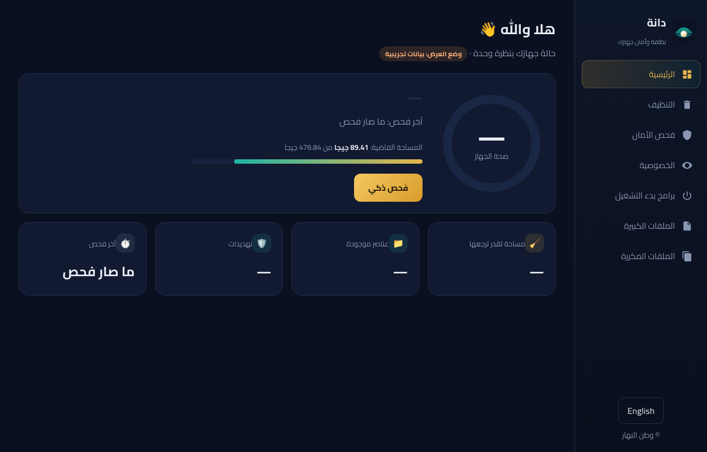
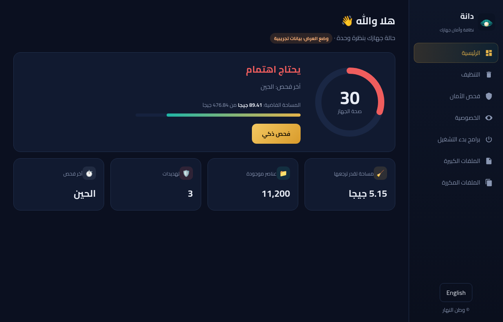
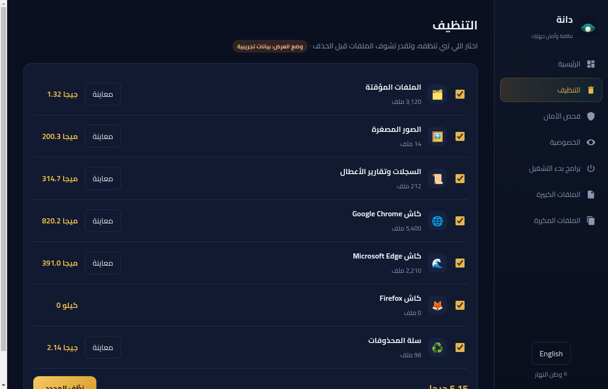
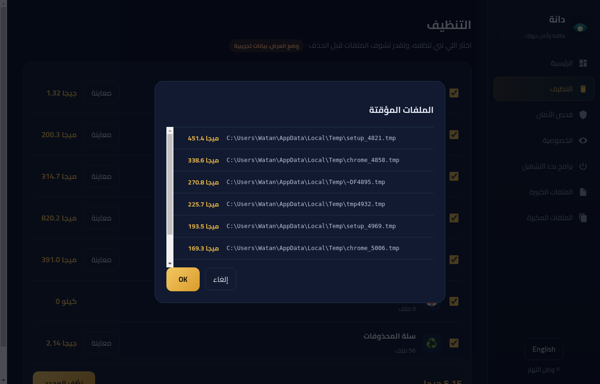
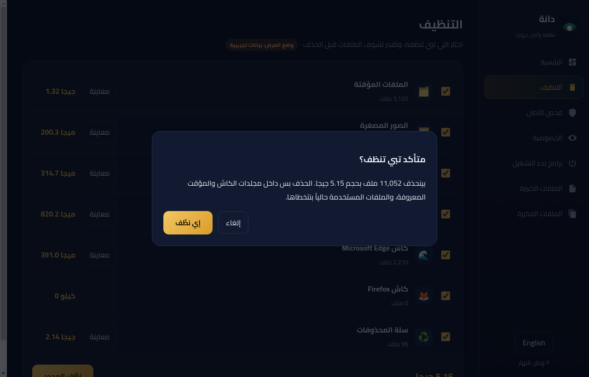
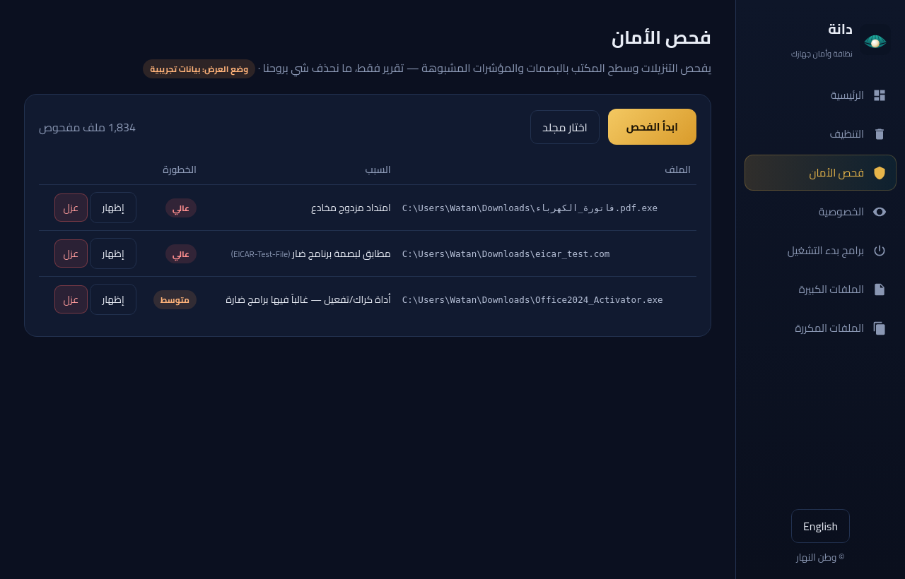
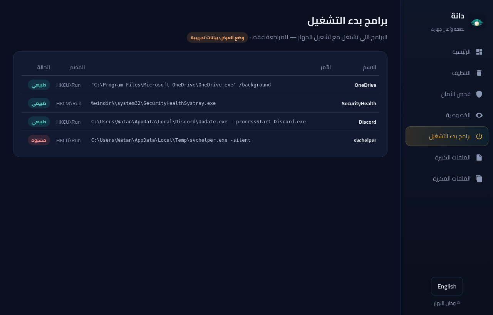
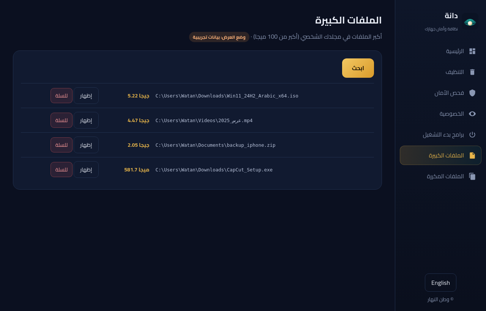
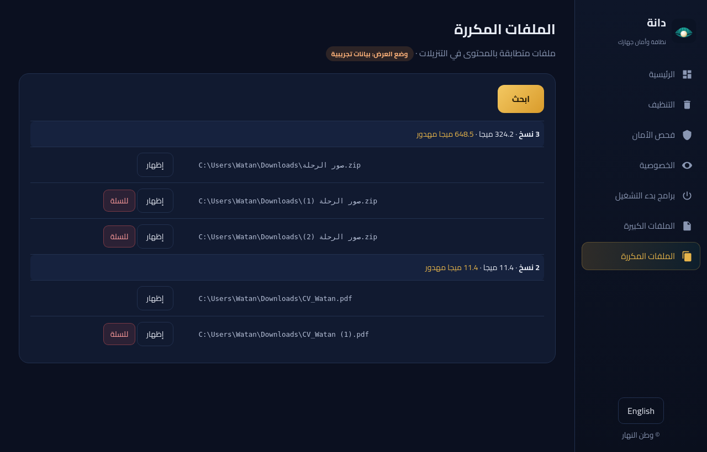
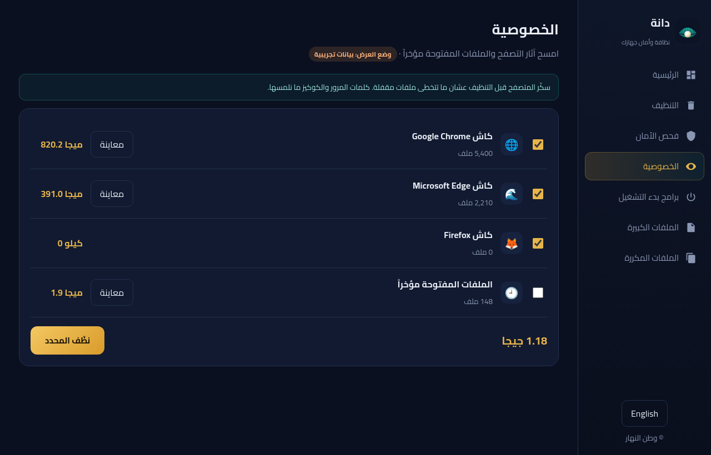
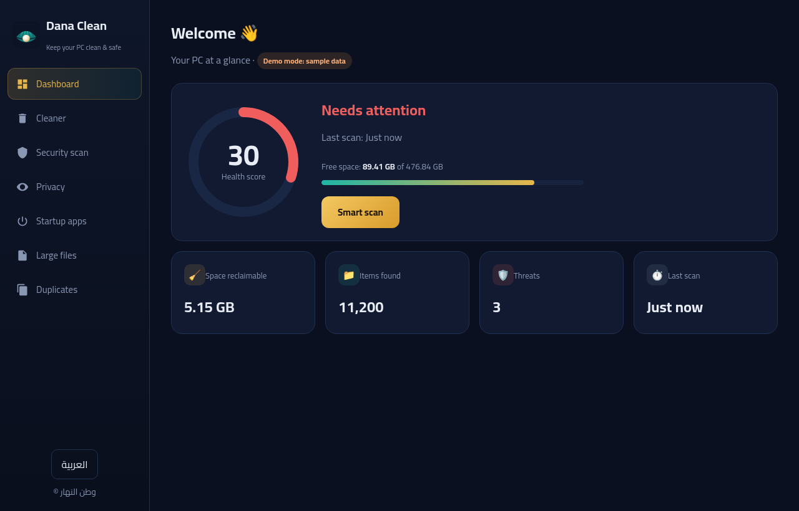
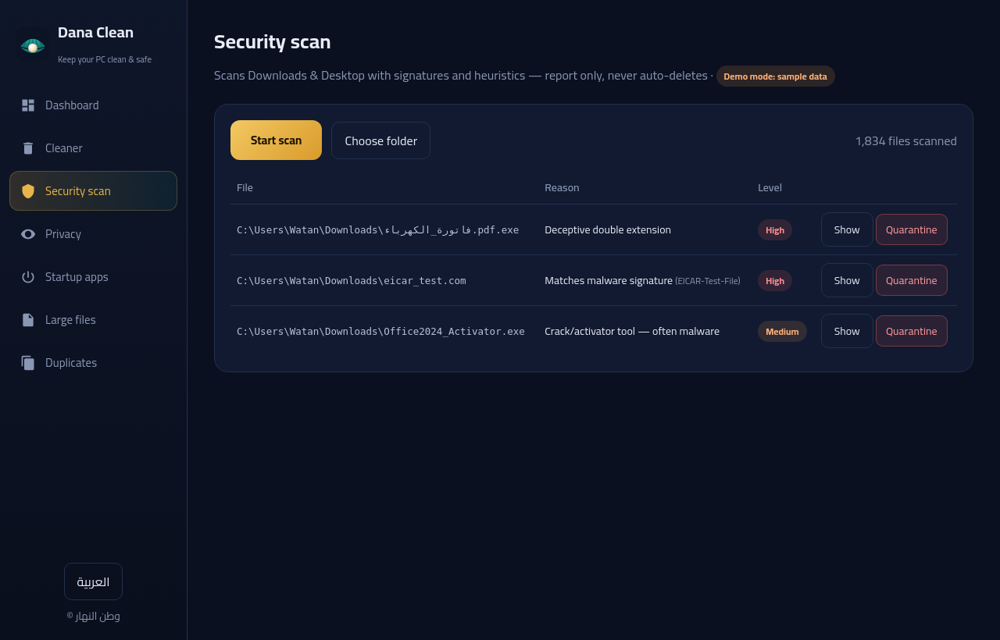
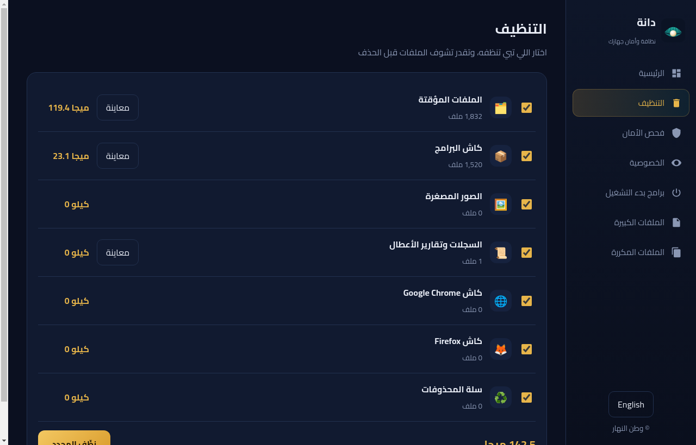
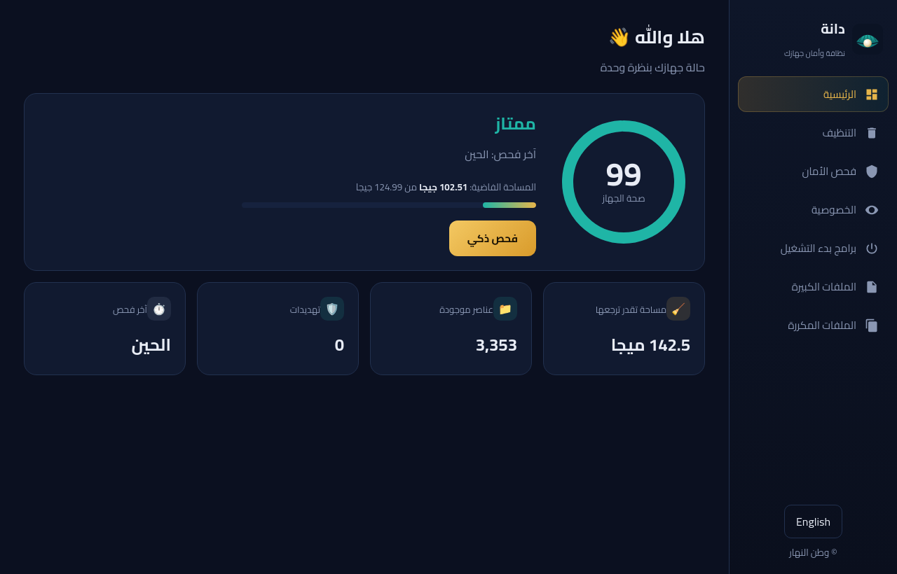

## الحقوق
جميع الحقوق محفوظة — انظر [LICENSE](LICENSE).
